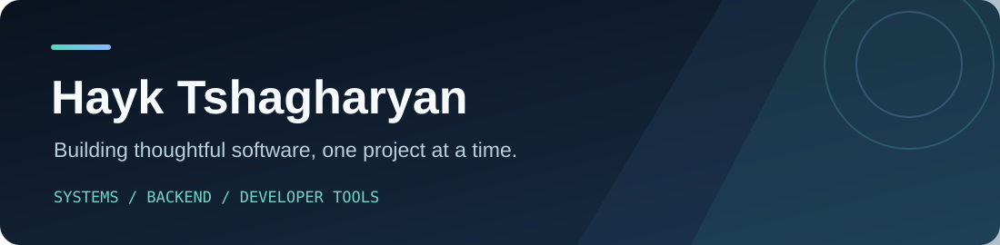

### Hi, I'm Hayk 👋

I build small, focused projects across **C++ systems**, **Python services**, and **TypeScript APIs**. I care about clear interfaces, useful tests, and documentation that says what a project actually does.

[Projects](#selected-projects) · [What I'm exploring](#what-im-exploring)

## Selected projects

| Project | Focus | Status |
| --- | --- | --- |
| [Multithreaded Task Scheduler](https://github.com/hayktshagharyan9-stack/multithreaded-task-scheduler) | C++17 thread pool, futures, graceful shutdown | Prototype |

## What I'm exploring

- **Performance engineering:** repeatable benchmarks and clear measurement reports.
- **Backend systems:** asynchronous document workflows and scheduling APIs.
- **Developer tools:** repository inspection and engineering automation.

I publish projects as they take shape. Each repository describes its current scope and how to run it.

## Tools I use

`C++` · `Python` · `TypeScript` · `CMake` · `FastAPI` · `PostgreSQL` · `Docker`

Open a project above to see its code, design choices, and next steps.

